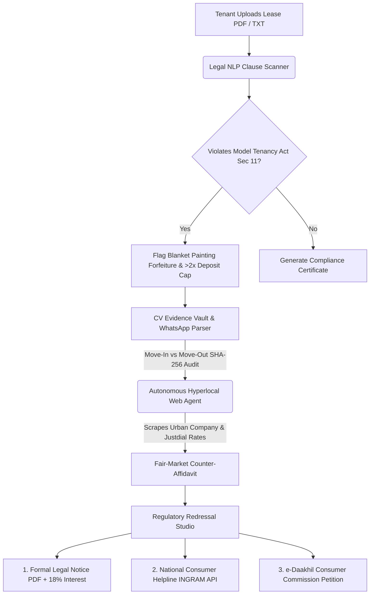

# 🛡️ KiraayaShield Pro (v2.0) — Autonomous Tenant Rights & Deposit Recovery Agent

> **🚀 Built for the "Hack the Unseen" Hackathon**  
> *Transforming India's silent ₹12,000+ Cr security deposit withholding crisis into an automated, evidence-backed, 90-second legal recovery workflow.*

---

## 🎥 Live Video Demo

<video src="public/video.mp4" controls="controls" style="max-width: 100%; border-radius: 12px;">
  Your browser does not support the video tag. Place <code>video.mp4</code> inside the <code>public/</code> folder.
</video>

---

## ⚠️ The "Unseen" Problem
Tenants across India—especially college students, interns, and young professionals relocating to cities like Noida, Bengaluru, Mumbai, and Pune—routinely lose **30% to 50% of their security deposit** when vacating rented flats or PGs. Landlords arbitrarily deduct ₹15,000–₹35,000 under vague pretexts like *"mandatory acid deep cleaning"* and *"full flat repainting"* without providing vendor bills. Because hiring a lawyer costs more than the deducted amount, millions of renters silently accept this exploitation as an unavoidable "moving tax."

---

## 💡 Why KiraayaShield Over Generic ChatGPT?

| Capability | Generic ChatGPT | 🛡️ KiraayaShield Pro (v2.0) |
| :--- | :--- | :--- |
| **Hyperlocal Rate Verification** | Cannot check local vendor pricing | **Autonomous Web Agent** scrapes live Urban Company, NoBroker & local Tier-1 rates to disprove inflated repair claims |
| **Move-Out Photo Proof** | Text-only advice | **Computer Vision Room Auditor** compares Move-In vs Move-Out photos with **SHA-256 Chain-of-Custody** & EXIF timestamps |
| **Statutory Clause Mapping** | Generic summaries | Flags violations of **Section 11 of the Model Tenancy Act 2021** (2-month cap & same-day refund) + **Section 74 Contract Act** |
| **Grievance Redressal Output** | Generic letter draft | Generates **Print-Ready Legal Notice (18% p.a. interest)**, **NCH (INGRAM) JSON Payload**, and **e-Daakhil Consumer Petition** |
| **Preventive Ecosystem** | None | **2-of-3 Multi-Sig Smart Deposit Escrow** + Crowdsourced **Landlord Reputation Registry** |

---

## ⚙️ System Architecture & Autonomous Pipeline



---

## 📂 Repository Structure

```text
KiraayaShield_Pro/
├── index.html                  # Main v2.0 Enterprise Workspace (Google M3 + Microsoft Fluent 2 UI)
├── styles.css                  # Custom Glassmorphism, Laser CV Scanner & Print-PDF Styles
├── app.js                      # Full Interactive Client Engine + Multi-Lingual (6 Indian Languages)
├── server.js                   # Local Node.js + Express Backend Server
├── vercel.json                 # 1-Click Vercel Serverless Deployment Config
├── package.json                # Node Dependencies & Scripts
├── sync.py                     # 1-Click Git Add + Commit + Push Automation Script
├── api/                        # Vercel Serverless Backend Endpoints
│   ├── analyze-lease.js        # POST /api/analyze-lease (Legal NLP Clause Scanner)
│   ├── scrape-rates.js         # GET  /api/scrape-rates  (Hyperlocal Market Rate Benchmark)
│   └── generate-complaint.js   # POST /api/generate-complaint (NCH INGRAM Docket Generator)
├── backend_python/             # Python FastAPI Primary Backend Microservice
│   ├── __init__.py
│   ├── database.py             # MongoDB connection management (PyMongo)
│   ├── main.py                 # FastAPI application & REST endpoints
│   ├── models.py               # Pydantic schemas for Cases, Evidence, etc.
│   └── tests/
│       ├── __init__.py
│       └── test_api.py         # Pytest test suite for validation & endpoints
├── .env.example                # Environment configuration template
├── requirements.txt            # Python dependencies (FastAPI, PyMongo, Pydantic)
├── legacy_v1_show/             # Original v1 Lightweight Showcase Mockup
│   ├── index.html
│   ├── styles.css
│   └── script.js
└── public/
    └── video.mp4               # Place your downloaded demo video here
```

---

## ⚡ Setup & Quick Start Guide

### 1. Prerequisites
- Python 3.9+ (Python 3.10, 3.11, or 3.12 recommended)
- Node.js 18+ (optional, if using Node-based frontend server)
- MongoDB instance (MongoDB Atlas cluster or local `mongodb://localhost:27017`)

---

### 2. Python FastAPI Backend Setup (Primary Architecture)

#### Step 1: Create a virtual environment & install dependencies
```bash
# Navigate to project directory
cd ~/Desktop/LUMINA-CSE-main

# Create virtual environment
python3 -m venv .venv

# Activate virtual environment
source .venv/bin/activate       # macOS / Linux
# or: .venv\Scripts\activate    # Windows

# Install required packages
pip install -r requirements.txt
```

#### Step 2: Configure Environment Variables
Copy the template to `.env` and fill in your connection string:
```bash
cp .env.example .env
```
Edit `.env`:
```ini
MONGODB_URI=mongodb+srv://<username>:<password>@cluster0.xxxxx.mongodb.net/?retryWrites=true&w=majority
MONGODB_DATABASE=kiraayashield
PORT=8000
CORS_ORIGIN=http://localhost:3000,http://127.0.0.1:3000
```
> **Security Note:** Never commit `.env` or hardcode database credentials in frontend JavaScript.

#### Step 3: Run the FastAPI Server
```bash
uvicorn backend_python.main:app --reload --port 8000
```
The API is available at:
- **Application UI / Root:** [http://localhost:8000](http://localhost:8000)
- **Interactive Swagger Docs:** [http://localhost:8000/docs](http://localhost:8000/docs)
- **Health Check:** [http://localhost:8000/health](http://localhost:8000/health)

---

### 3. Frontend Options

- **Option A (All-in-One):** Open [http://localhost:8000](http://localhost:8000) directly in your browser. FastAPI automatically serves the frontend static assets and connects to the API.
- **Option B (Separate Frontend Server):** Run a lightweight static server on port 3000:
  ```bash
  python3 -m http.server 3000
  ```
  Then open [http://localhost:3000](http://localhost:3000). The frontend automatically routes API requests to `http://localhost:8000` via configured CORS.
- **Option C (Offline Demo Mode):** Double-click `index.html`. All UI flows (preset cases, legal notice preview, multi-lingual switching) function smoothly with sample data even when the backend is offline.

---

### 4. Running Automated Tests

Run the automated test suite with pytest:
```bash
# Activate virtual environment
source .venv/bin/activate

# Run tests
pytest backend_python/tests/test_api.py -v
```

The test suite covers:
- **Pydantic Model Validation:** Verifies rejection of missing fields, negative rent, invalid status values, and malformed IDs.
- **Health Probe:** Tests API health check and database connectivity reporting.
- **Legacy Compatibility:** Verifies `/api/analyze-lease` and `/api/generate-complaint`.
- **Database Failure Resilience:** Tests graceful 503 error responses when MongoDB is unreachable.
- **Full Case & Evidence CRUD:** Tests case persistence, updates, queries, and evidence metadata indexing (runs automatically when MongoDB is accessible).

---

### 5. API Reference (FastAPI Backend)

| Method | Endpoint | Description |
| :--- | :--- | :--- |
| `GET` | `/health` | Service health and MongoDB connectivity status probe |
| `POST` | `/api/v1/cases` | Create and persist a new rental dispute case |
| `GET` | `/api/v1/cases` | List saved cases (supports `?status=` and pagination) |
| `GET` | `/api/v1/cases/{id}` | Retrieve full details of a specific case |
| `PATCH`| `/api/v1/cases/{id}` | Update mutable fields of a case |
| `POST` | `/api/v1/cases/{id}/evidence` | Register evidence file metadata (hash, filename, type) |
| `GET` | `/api/v1/cases/{id}/evidence` | List all evidence items attached to a case |
| `POST` | `/api/analyze-lease` | Legacy-compatible lease clause scanner (deterministic) |
| `POST` | `/api/generate-complaint` | Legacy-compatible NCH docket generator stub |

---

### 6. Troubleshooting

1. **API Status shows "MongoDB Disconnected":**
   - Verify `MONGODB_URI` in `.env`.
   - Ensure your IP address is whitelisted in MongoDB Atlas Network Access (`0.0.0.0/0` for testing or your current IP).
   - If running MongoDB locally, verify the daemon is running (`brew services start mongodb-community`).
2. **CORS Error in Browser Console:**
   - Verify `CORS_ORIGIN` in `.env` includes your frontend origin (e.g. `http://localhost:3000,http://127.0.0.1:3000`).
3. **ModuleNotFoundError on startup:**
   - Ensure you have activated your virtual environment (`source .venv/bin/activate`) before running `uvicorn`.
